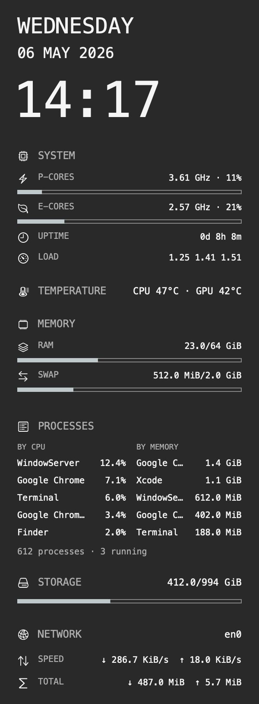
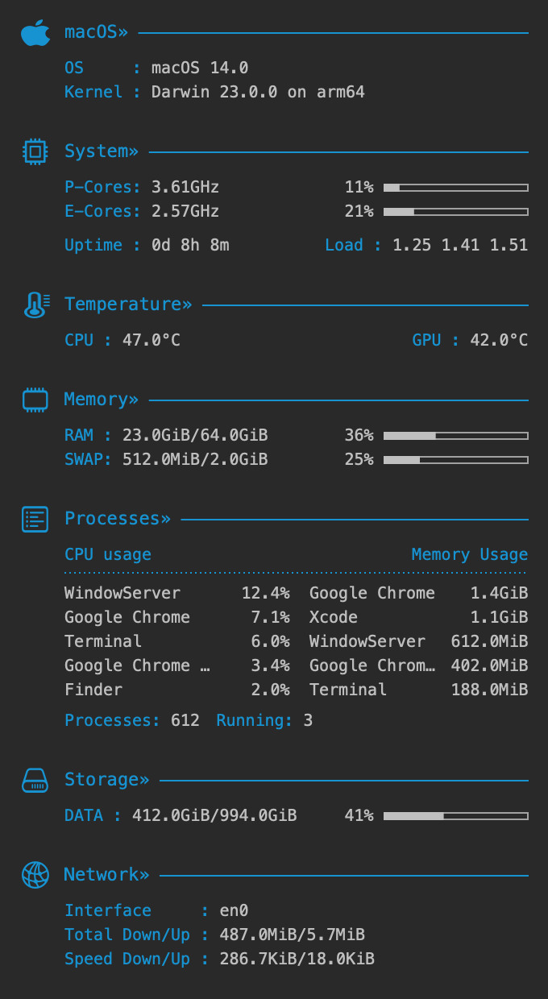
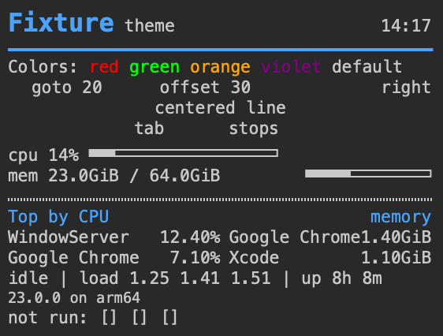

# ConkyMac

A native macOS desktop system monitor in the spirit of [Conky](https://github.com/brndnmtthws/conky). It ships three built-in themes and can also run many existing Conky themes: `conky.text` templates are laid out with CoreText, and Lua/Cairo scripts draw through a CoreGraphics implementation of the cairo API. No Cairo, X11 or Conky code is involved.

> **Status: alpha.** Apple Silicon only, macOS 14 or later. Tested on an M4 Max and an M5 MacBook Air running macOS 27; see [Tested hardware](#tested-hardware).

<p>
  
  
  
</p>

*Simple Plus, Minimalis, and a `conky.text` test theme, rendered from fixed sample data with `--render`.*

## Features

- **Desktop panels.** One transparent panel at the top-right of every display, below the desktop icons, in every Space, and still visible during the Show Desktop gesture. Clicks pass through to the desktop.
- **Metrics.** CPU load (total, per core, history), P/E cluster frequency and load, CPU and GPU temperature, RAM and swap, storage, battery, uptime and load average, network speed and session totals, and the top processes by CPU and by memory.
- **Built-in themes.** *Simple Plus* (default), *Simple* and *Minimalis*, native re-creations of popular Conky layouts.
- **Conky themes.** Conky 1.10+ `.conf` files with `conky.text` and/or Lua draw hooks. See [Conky compatibility](docs/conky-compatibility.md).
- **Low overhead.** One shared sampler at 1 Hz. Panels hidden behind windows are not redrawn, and the expensive readings pause until a panel is visible again. See [Performance](docs/architecture.md#performance).
- **Safe with downloaded themes.** Template commands that run programs or read files (`exec`, `cat`, `lua_parse`, ...) are never executed, and Lua runs in a sandbox with time and memory limits. See [Security model](docs/conky-compatibility.md#security-model).

## Install

1. Download the latest `ConkyMac-<version>.dmg` from [Releases](https://github.com/cchen7/conkymac/releases).
2. Open it and drag **ConkyMac** to **Applications**.
3. Launch it. Use the menu bar icon to switch themes, open a preview window, hide the panels or quit.

Releases are signed with a Developer ID certificate, notarized and stapled, so Gatekeeper accepts them offline. The app needs no entitlements or special permissions.

## Using Conky themes

Put each theme in its own folder:

```
~/Library/Application Support/ConkyMac/Themes/<name>/<name>.conf
```

Lua scripts referenced by `lua_load` are resolved relative to the `.conf` file. The **Theme** menu rescans this folder every time it opens.

Icon fonts used by many themes (for example ConkySymbols or a Nerd Font) are not bundled. Install them into `~/Library/Fonts`; until you do, icons show up as letters.

## Command line

```
/Applications/ConkyMac.app/Contents/MacOS/ConkyMac [options]
```

| Option | Description |
| --- | --- |
| `--theme ID\|PATH` | Built-in theme (`simple-plus`, `simple`, `minimalis`) or a Conky `.conf`. Overrides the menu choice without saving it. |
| `--preview` | Show a single normal window instead of desktop panels. |
| `--interface NAME` | Network interface to report (default: the system's primary interface, which may be a VPN). |
| `--icon-margin N` | Extra right margin on the main display for desktop icons, 0–600 pt (default 120). |
| `--diagnostics` | Report unsupported template variables and blocked commands on stderr. |
| `--sensors` | Print what the temperature and frequency readers find on this Mac, then exit. Useful in bug reports. |
| `--probe N` | Print N real snapshots as JSON lines at 1 Hz, then exit. |
| `--render PATH` | Render the theme with fixed sample data to a PNG (`--scale 1\|2`, default 2), then exit. |
| `--smoke N` | Run the GUI for N snapshots, print a summary, then exit. |

## Tested hardware

| Mac | macOS | What was verified |
| --- | --- | --- |
| M4 Max | 27.0.1 | Everything in this repository: tests, dual-display desktop runs, performance, packaging |
| M5 (MacBook Air) | 27.0.1 | Installation, temperature and frequency readings (0.1.1) |

Temperature and frequency come from private interfaces (SMC and IOReport) whose key names change between chip generations. Other chips (M1–M3, M4 Pro, base M4, M5 Pro/Max) are untested and may show N/A. macOS 14–26 is untested even though it is the deployment target. See [Sensors](docs/sensors.md) for details. Bug reports with `ConkyMac --sensors` output are welcome.

## Building from source

Requires Xcode with the Swift 6 toolchain. There are no package dependencies.

```sh
zsh scripts/build-app.sh                         # Release build of ConkyMac.app (ad-hoc signed)
open /private/tmp/conkymac-build/ConkyMac.app --args --preview
zsh scripts/swift.sh test -c release             # Unit tests
zsh scripts/validate.sh --gui                    # Tests, renders, live sampling and a GUI smoke run
```

See [Development](docs/development.md) for the build layout, test fixtures and the signed release pipeline.

## Known limitations

- Conky graphs (`cpugraph`, `downspeedgraph`, ...) are not drawn yet; their space is reserved.
- Window placement settings (`alignment`, `gap_x`, `own_window_*`) are ignored; panels always sit at the top-right of each display.
- Weather, calendar and GPU load are not available.
- Not yet tested by hand: sleep/wake, display hot-plugging, Stage Manager.

## Documentation

- [Conky compatibility](docs/conky-compatibility.md): configuration, `conky.text`, variables, the cairo subset, and the security model
- [Architecture](docs/architecture.md): sampling, rendering, the Lua bridge, metric definitions and performance
- [Sensors](docs/sensors.md): temperature and frequency on Apple Silicon
- [Development](docs/development.md): building, testing and releasing
- [Changelog](CHANGELOG.md)

## Acknowledgements

- [Conky](https://github.com/brndnmtthws/conky) for the configuration and template semantics this app follows.
- [Stats](https://github.com/exelban/stats) for its memory, network and Apple Silicon sensor readers.
- [Simple-Conky-theme](https://github.com/Abs-30/Simple-Conky-theme) and Minimalis Conky by archit3x, whose layouts inspired the built-in themes.
- [Lua 5.4](https://www.lua.org/), embedded unmodified.

## License

ConkyMac is released under the [MIT License](LICENSE). Third-party components and references are listed in [THIRD_PARTY_NOTICES.md](THIRD_PARTY_NOTICES.md).
