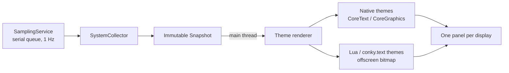

# Architecture

ConkyMac is a Swift 6 package with no third-party package dependencies.

| Target | Language | Role |
| --- | --- | --- |
| `ConkyMacCore` | Swift | Metric collection, snapshots, sampling schedule; the `conky.text` parser and variable evaluator. No AppKit, so it is unit-testable. |
| `ConkyMac` | Swift | The app: AppKit windows, menu, native themes, the CoreText `conky.text` renderer, the Lua theme host, the command line. |
| `ConkyLuaBridge` | C | Embeds Lua, loads Conky configs, and implements the cairo subset on CoreGraphics and CoreText. |
| `CLua` | C | Lua 5.4.9, unmodified. |
| `CSystemPrivate` | C | Declarations for the private SMC and IOReport interfaces. |

## Data flow

1. A single `DispatchSourceTimer` on a background serial queue samples once per second and produces an immutable `Snapshot`. Every panel and every theme reads the same snapshot.
2. The snapshot is delivered to the main thread, where the active theme prepares and draws it.
3. Native themes draw directly into each panel's view.
4. Lua and `conky.text` themes are drawn once per snapshot into a shared offscreen bitmap. Its scale is `max(backing scale of any screen, 2)`, and every panel then draws that cached image.

### Sampling cadence

| Reading | Interval | Source |
| --- | --- | --- |
| CPU (total and per core), memory, swap, network, load average | 1 s | `host_statistics`, `host_processor_info`, `sysctl`, `NET_RT_IFLIST2` |
| Frequency and cluster load | 2 s | IOReport residency weighted by the pmgr DVFS tables |
| Temperature | 5 s | SMC |
| Process ranking | 5 s | `/bin/ps` |
| Storage, battery | 30 s | File system attributes of the data volume, IOPowerSources |

Frequency, temperature and the process ranking are "details". When every panel is covered by other windows, details pause and the panels are not redrawn. Each panel redraws as soon as it becomes visible again. CPU, memory and network keep sampling so rates and history stay continuous.

Hiding the panels or sleeping stops the timer. On resume, the baselines for CPU and network deltas are rebuilt and the slow caches are refreshed.

## Windows

- Desktop mode places one borderless, transparent panel per display at the top-right, 15 pt from the edges. On the main display it moves another 120 pt left (configurable with `--icon-margin`) so it does not cover Finder's desktop icons.
- Panels sit one level below the desktop icons. They join all Spaces, stay visible during Show Desktop, and ignore mouse events.
- Panels are rebuilt when the screen configuration changes.
- Preview mode shows a single normal window instead.
- In desktop mode, native themes draw a soft shadow on one transparent layer so text stays readable on light wallpapers. Lua themes draw their own shadows.

## Metric definitions

| Metric | Definition |
| --- | --- |
| CPU | Difference of the four tick counters between samples, normalised to 0–1. There is no value until the second sample. |
| RAM | active + inactive + speculative + wired + compressed − purgeable − external pages (the formula used by Stats). Not calibrated against Activity Monitor. |
| Storage | Total and free bytes of `/System/Volumes/Data`. APFS shared and purgeable space may differ from Finder. |
| Battery | The internal battery via IOPowerSources. A missing battery and a failed read are reported differently. |
| Uptime | Time since `kern.boottime`. |
| Network | Byte counters of the system's primary interface; physical and VPN interfaces are not added together. Rates use `mach_continuous_time`, which keeps counting during sleep. A gap over 5 s, a change of interface or an unexplained counter decrease starts a new baseline. |
| Session totals | Sum of the deltas over intervals the app actually sampled. Totals survive baseline resets, and traffic while sampling was paused is not counted. |
| Processes | One `ps -A -o pid=,%cpu=,rss=,state=,comm=` run gives the CPU ranking, the memory ranking, the process count and the running count. CPU% is ps's decaying average (100% = one core); memory is RSS. |

**Network counters are truncated.** On the macOS 27 systems tested, an unprivileged process receives `⌊(64-bit counter mod 2³²) / 1024⌋ × 1024` from both `NET_RT_IFLIST2` and `getifaddrs`; `netstat` sees the exact value. ConkyMac therefore treats a small backwards jump as a 32-bit wrap. It only does so when the old value fits in 32 bits and the implied rate is at most 10 Gbit/s; anything else starts a new baseline. Rates move in 1 KiB steps.

**Why `/bin/ps`?** `proc_pid_rusage` fails with `EPERM` for about a third of processes, including WindowServer and other root processes. The setuid `ps` sees all of them. It runs through `posix_spawn` with `LC_ALL=C`, no inherited file descriptors, and a 1.5 s timeout after which it is killed.

## Lua bridge

- **Error boundary.** All Lua C functions and every `lua_pcall` live in C, so a Lua error (a `longjmp`) never crosses a Swift frame. Swift calls a small C API: open, draw pre, draw post, close, and read config. `conky_parse` calls back into Swift through a non-throwing `@convention(c)` closure that returns a C string, which C copies and frees.
- **cairo state.** Each `cairo_t` has its own transform, source (colour or gradient), line settings, clip chain and a 16-level save stack.
  - Paths are transformed as they are added, like cairo does, and kept per context.
  - Every drawing operation runs inside its own `CGContextSaveGState`/`RestoreGState` pair, with no Lua error possible in between, so the base transform never drifts.
- **Clipping.** A CoreGraphics clip does not outlive one operation, so each state holds a reference-counted, immutable chain of clip paths that is replayed for every drawing operation.
- **Fonts.** A 32-entry LRU cache of CoreText fonts lives in the per-theme state and is released after `lua_close`. There is no global mutable state, so themes and tests are independent.
- **Text.** Glyph outlines are converted to a path and filled through the same code as `cairo_fill`, so colours, gradients, clipping and operators apply to text too.

## `conky.text` pipeline

1. **Bridge.** It copies `conky.text` and the scalar entries of `conky.config` out of Lua.
2. **Parser.** `ConkyTextParser` turns the text into nodes: text, newlines and objects.
3. **Evaluator.** `ConkyText.lines` resolves conditions, colours, fonts and variables against a snapshot. The result is lines of items: text runs, cursor moves, rules, bars and graph placeholders. Conditions use an explicit stack, not recursion.
4. **Renderer.** `ConkyTextRenderer` (main thread) follows Conky's cursor model:
   - Each line advances by the largest ascent on it and then by the descent of its last font.
   - `goto` uses window coordinates and `voffset` accumulates.
   - `alignr` and `alignc` reserve the width of the rest of the line.
   - It lays out twice: first to find the natural width, then to place everything against the final width.
   - It caches up to 32 fonts and 256 `CTLine`s.

The variable evaluator is shared with `conky_parse`, so Lua scripts and `conky.text` print identical values.

## Performance

Measured on an M4 Max with a Release build. Each figure comes from a single run, and runs vary noticeably. There is no Instruments profile yet.

| Scenario | Result |
| --- | --- |
| Simple Plus, one panel visible, 180 s, measured alongside iStat Menus | ConkyMac about 1.4% of one core, plus about 0.5% for the `ps` child; iStat Menus about 1.3% |
| All panels covered | Sampling about 0.17% of one core; nothing is redrawn |
| Two third-party `conky.text` themes, two displays, 90 s each | About 2.2% of one core including `ps`; 77 MB peak RSS; render p50 2.7–3.2 ms, p95 3.8–4.6 ms |
| Lua ring and clock themes | Draw hook p50 2.6–6.6 ms, p95 4.2–8.2 ms, including rasterisation |

Cost breakdown per run:

| Work | Cost per run |
| --- | --- |
| Frequency | about 5.5 ms |
| Temperature | about 2.5 ms |
| `ps` | about 4 ms in the app, about 26 ms in the child |
| Network | about 0.4 ms |

Drawing into one shared bitmap for two native-theme panels was tried and measured worse than AppKit's per-view layers, so native themes draw per panel.
