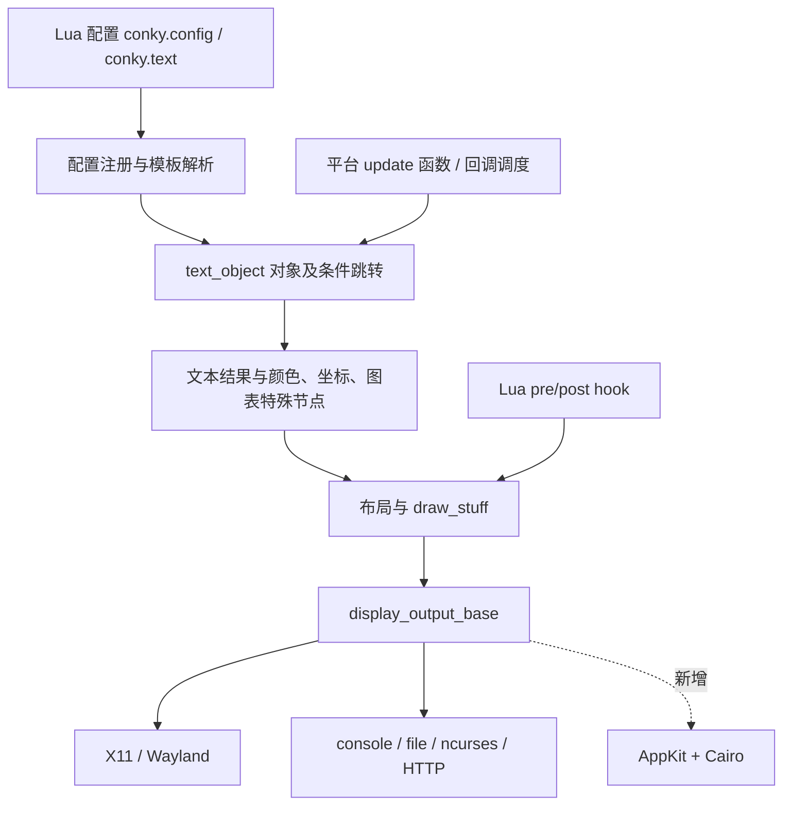

# Conky macOS 主题迁移可行性调研

调研日期：2026-10-14。对应任务拆解见 [macos-roadmap.md](macos-roadmap.md)。

开发仓库已选定为 [cchen7/conkymac](https://github.com/cchen7/conkymac)，本地目录为 `/Users/chenxin/Local/conkymac`。下面的构建与测试结果来自独立保留的 Conky 上游检出 `/Users/chenxin/Local/conky`，不是 ConkyMac 原生应用的验证结果。

## 1. 目标与结论

用户最终明确的目标是：在 macOS 上复刻 Conky 的桌面监控体验，尤其复用生态里漂亮的外观主题。允许转换配置、修改 Lua 脚本、替换平台数据源，不要求所有历史配置原封不动运行，也不要求覆盖 Conky 的全部功能。

**可行。结合高性能原生应用目标，最新建议以 Swift 构建运行核心，提供原生主题与 Lua/Cairo 适配两条路径。** 应用、共享采集、调度、主题模型与原生渲染由 Swift 负责；Conky 作为语法和主题行为参考，复杂 Lua 圆环、钟表主题保留绘图算法并逐步转换。具体模块选择、源码成本观察与验证结果见 [Swift 原生架构与性能决策](swift-native-architecture.md)。

这里的“原生”指应用、窗口、桌面行为、数据与生命周期使用 macOS 能力；原生主题使用 CoreGraphics/CoreText/Core Animation，复杂主题可以保留 Cairo。原生与兼容路径各自测量，不能把语言选择本身当成性能保证。

Conky 已有 Darwin 采集实现，现有引擎在本机的无图形构建、测试和小范围运行验证成功。**缺少原生 AppKit 显示后端**，现有 Darwin 采集也并不完整。Stats 提供了更现代的采集参考，尤其是 Apple Silicon 传感器。

尚未验证：Cocoa 后端的真实画面、Retina 排版、桌面层级、Spaces/Stage Manager 行为、主题视觉一致性、长期资源占用。不能据本次命令行成功宣称主题已经可以运行。

## 2. 调研基线与证据等级

| 项目 | 本次实际状态 |
| --- | --- |
| Conky 检出目录 | `/Users/chenxin/Local/conky`，分支 `main` |
| Conky 提交 | `0bee35ce5befb7d84bb7494cd83c2313dac75387`，2026-10-13 |
| Conky 版本 | `1.25.4-pre-0bee35ce`；`git describe` 为 `v1.25.3-6-g0bee35ce` |
| Stats 参考提交 | `88d5359ad3466efaa16985646a0bb15c6599109f`，2026-10-12 |
| Stats 参考检出 | `/private/tmp/conky-feasibility-20261014/stats`，临时浅克隆 |
| 本机 | Apple M4 Max，16 核 CPU，64 GiB 内存，arm64，macOS 27.0.1 |
| Apple 工具链 | 完整 Xcode 选中；Swift 6.4，AppleClang 21，macOS SDK 27 |
| 构建工具 | 临时 Python venv 内 CMake 4.4.4；使用系统 Make |
| 现有 Lua | Homebrew Lua 5.5.1；本次仅复用，未修改安装 |

本报告把“源码存在”“文档支持”“本机采样成功”和“建议设计”分开。对第三方项目的分析是架构与关键路径调研，不等同于逐行代码审计。

DeepWiki 用于定位模块。它的 Conky 索引没有覆盖本次源码已有的 `conky_surface()`；Stats 回答也把普通读取和特权操作混在一起，并将硬件信息查询误概括为内存使用量采样。相关结论均用检出源码和探针纠正，不能直接沿用 AI 摘要。

## 3. Conky 实际架构



### 3.1 配置与模板引擎

- `src/main.cc` 是 CLI 入口；`src/conky.cc` 承担配置加载、初始化、重载、生成文本和绘制主流程。
- 配置是可执行 Lua：`conky.config` 设置参数，`conky.text` 保存模板。它可能包含计算和动态构造，不能把所有配置当成静态键值文件。
- `src/lua/setting.*`、`lua-config.*`、`luamm.*` 负责配置注册、转换和 Lua/C++ 交互。
- `src/core.cc::construct_text_object()` 用 `OBJ` 系列宏注册变量。`src/content/text_object.h` 定义双向链表、子对象、条件跳转与旧/新回调接口。
- 格式指令不是简单字符串替换：`src/content/specials.*` 维护颜色、字体、坐标、对齐、进度条、仪表和带历史的图表；`src/conky.cc` 完成布局及绘制。
- `extras/convert.lua` 提供旧配置语法向 Lua 配置转换。这是已有能力，但它不负责 Linux→macOS 平台迁移。

文档 YAML 中本次统计到 429 个变量名称条目、119 个配置名称条目、28 个 Lua 文档名称条目。这些包含受平台、编译选项和生命周期影响的条目，**不代表 macOS 支持 429 个变量**。

### 3.2 采集与调度

- `src/data/os/` 有 Linux、Darwin、BSD 等实现；平台函数主要通过共享 `info` 和 `update_*` 接口接入。
- `src/update-cb.hh` 与 `update-cb.cc` 负责按周期注册和去重复回调；部分任务异步，部分回调等待完成。
- `src/data/data-source.hh` 有数据源注册抽象，但大量模板变量仍走 `core.cc` 和 `text_object` 回调，不能误以为全部数据源已封装成独立插件。
- `main_loop()` 按更新间隔调度。图形输出调用后端 `main_loop_wait()`；非图形输出休眠后执行 `update_text()`、`draw_stuff()`、`flush()`。
- 核心有全局配置、Lua 状态、字体和绘制状态。`draw_stuff()` 明确假定一个图形输出。直接嵌入 SwiftUI 多组件、多实例不是现成接口。

### 3.3 显示后端

`src/output/display-output.hh::display_output_base` 已提供初始化/关闭、事件等待、文字测量、字体、线条/矩形/圆弧、窗口移动、DPI、刷新与 `drawing_surface()` 接口。

这是增加 Cocoa 后端的合理入口，但并非只增加一个类即可：

| 需处理的边界 | 当前源码约束 |
| --- | --- |
| 后端选择 | `output-setting.*::output_t` 没有 Cocoa；选择和回退策略需要扩展 |
| GUI 编译 | `BUILD_GUI` 由 X11/Wayland 打开；原生后端必须独立打开 GUI 能力 |
| 窗口设置 | 多处由 `OWN_WINDOW || BUILD_WAYLAND` 控制；`OWN_WINDOW` 又依赖 X11 |
| Lua 窗口信息 | `llua_setup_window_table()` 只判断 X11/Wayland；新后端需纳入几何与缩放信息 |
| Lua 画布 | `draw_surface` 实际仍是 `cairo_surface_t`，适合继续使用 Cairo |
| 图片渲染 | 内置 Imlib2 路径仍引用 X11 窗口；需拆开解码与提交画面 |
| 字体和布局 | 需要实现后端测量与绘制，适配 fontconfig 风格字体描述和缺失字体 |
| 图形变量判断 | 某些代码列举 X11/Wayland/ncurses，需检查新后端是否被漏掉 |
| 自动重载 | 当前文件监视主要依赖 inotify；Darwin 需 DispatchSource/FSEvents 等替代 |
| 应用生命周期 | Conky 循环与 AppKit 主事件循环需要明确整合方式 |

Wayland 后端可参考 Cairo 绘图、字体和缩放处理，但它的 epoll、timerfd、layer-shell、缓冲提交等不可作为 macOS 窗口代码直接复用。

### 3.4 Lua 是主题复用的重点

`src/lua/llua.cc` 提供脚本加载、`conky_parse()`、更新间隔调整、生命周期及绘制 hook、鼠标 hook，以及 `conky_window`。

当前源码已有 `conky_surface()`，返回当前后端的 Cairo 画布。`doc/lua.yaml` 将其列为推荐的跨后端画布入口，并把 `conky_window.display/drawable/visual` 标为过时的 X11 字段。

因此应保留普通 Lua 和 Cairo 绘图逻辑，迁移旧脚本的画布获取方式，而非模拟真正的 Xlib 指针。直接使用 X11 API 的复杂脚本仍需人工处理。

## 4. 主题生态如何迁移

| 主题类型 | 复用方式 | 主要工作 | 判断 |
| --- | --- | --- | --- |
| 文字、时间、布局、进度条 | 保留模板或转成有限的布局节点 | 字体、对齐、字号、变量与平台参数 | 可行性高 |
| Lua+Cairo 圆环、钟表、渐变 | 保留绘图主体，修改画布入口 | hook、画布生命周期、Retina、指标映射 | 推荐优先支持 |
| PNG/SVG/图标字体与复合布局 | 保留获授权资源与几何关系 | 路径、字体、图片实现、混合渲染 | 中等工作量 |
| Shell/Python/外部播放器脚本 | 保留外观，替换采集脚本或服务 | `/proc`、`/sys`、Linux 工具、协议 | 逐主题处理 |
| Xlib 深度操作、多窗口/桌面状态 | 局部重写并定义降级 | 平台语义没有直接对应关系 | 不宜承诺自动迁移 |

本次实际读取了上游示例配置，以及两个社区 Lua 源码样本：

- [Air Clock](https://github.com/fxthomas/conky/blob/master/clock.lua)：钟面、玻璃感渐变、阴影、指针主要由 Cairo 构成；可见 X11 入口为画布创建。样本还需检查 Cairo 资源释放。
- [Ring Meters 样本](https://github.com/mptrsen/dotfiles/blob/master/.conky/rings.lua)：颜色、角度、半径、厚度和数据值独立；通过 `conky_parse()` 获取指标，画布入口依赖 X11。其具体版本还包含局部 hook 定义，不能视为开箱即用的测试主题。

这是两个代码样本，不是生态兼容率调查，也没有做本次画面验证。它们所在仓库的 GitHub 元数据未声明许可证；本次只放在临时目录阅读，不作为可分发产品资源引入。

### 4.1 画布转换示意

旧主题常见写法：

```lua
local cs = cairo_xlib_surface_create(
    conky_window.display, conky_window.drawable, conky_window.visual,
    conky_window.width, conky_window.height)
local cr = cairo_create(cs)
-- 原主题绘图
cairo_destroy(cr)
cairo_surface_destroy(cs)
```

新的后端画布入口：

```lua
local surface = conky_surface()
if not surface then return end
local cr = cairo_create(surface)
-- 保留原主题绘图
cairo_destroy(cr)
```

`conky_surface()` 是引擎提供的当前帧画布，不能沿用旧代码对自建 surface 的销毁，也不能跨帧缓存。如果显式取得额外引用，则只释放自己持有的引用。转换工具必须分析获取、引用、缓存和释放的关系，不能无条件替换一行后宣称完成。

### 4.2 转换工具的合理范围

第一版建议是“检测 + 有限转换 + 明确报告”：

1. 识别新/旧配置、Lua 文件、图片、字体、外部命令与相对路径。
2. 复用已有旧配置转换能力，保留原始主题，输出新副本和变更清单。
3. 对确定的 Xlib 画布模式改写为 `conky_surface()`，处理相应的 require 与释放关系。
4. 映射网络接口、挂载路径、字体、窗口设置和 macOS 指标。
5. 列出 Linux 命令、未知 X11 调用、无法解析的动态结构和需要人工指定的参数。
6. 用固定时间/指标输出离屏截图，再用真实数据在桌面验证。

Lua 是通用语言。任意动态 Lua→SwiftUI/声明式布局无法保证自动、完整、语义等价。有限模式适合语法树转换，复杂主题可以逐个人工迁移，并把重复模式沉淀成规则。

## 5. macOS 数据采集：Conky 与 Stats 的分工

Conky 的 `src/data/os/darwin.mm` 已实现 CPU、内存/交换、网络、进程、uptime 等路径。但电池、AC 状态、ACPI 温度、风扇和 `update_diskio()` 仍存在明确 STUB。频率默认读取 `HW_CPU_FREQ`，另有 Intel Power Gadget 选项，不适合作为 M4 的动态频率实现。

Stats 参考版本采用 MIT 许可证，其读数代码分布如下：

| 指标 | Stats 主要文件 | 实现方式与迁移建议 |
| --- | --- | --- |
| CPU 利用率 | `Modules/CPU/readers.swift` | `host_processor_info` 差分；Conky 已有路径，可比较采样语义 |
| 内存、压缩、压力、swap | `Modules/RAM/readers.swift` | Mach VM 统计、sysctl；公式区分压缩、可清除和文件缓存，比 Conky 简单“总量减 free”更适合解释 macOS 内存 |
| 电池、充电 | `Modules/Battery/readers.swift` | IOPowerSources；额外详情使用 IORegistry 与 SMC，优先实现公共电源读数 |
| 网络流量 | `Modules/Net/readers.swift` | getifaddrs/接口计数差分；Wi-Fi 详情另有定位权限处理 |
| 磁盘 I/O | `Modules/Disk/readers.swift` | IORegistry `Statistics` 的读写字节累计值；需按实际时间转速率、处理设备变化 |
| GPU 利用率 | `Modules/GPU/reader.swift` | IOAccelerator/IORegistry `PerformanceStatistics`；属性取决于设备与系统 |
| SMC 温度/风扇转速 | `SMC/smc.swift`、`Modules/Sensors/values.swift` | AppleSMC user client 与型号传感器映射；已有 M4/M4 Max 表 |
| HID 温度 | `Modules/Sensors/reader.m`、`bridge.h` | Apple Silicon IOHID 事件采集、缓存发现和唤醒后的重建 |
| 功耗 | `Modules/Sensors/readers.swift` | IOReport Energy Model 累计能量差分除以采样时间，处理 mJ/uJ/nJ |
| E/P 核频率 | `Modules/CPU/readers.swift`、`Kit/plugins/SystemKit.swift` | IOReport 驻留时间与 pmgr 频点表组合计算；不是简单读取单个频率属性 |

Stats 的 `Reader<T>`、`Store`、`SystemKit`、模块数据模型和 UI 有关联，不能将一个 `readers.swift` 文件直接放进 Conky 即完成接入。可选择移植小段算法到 Objective-C++，或把必要 Swift 读取逻辑封装成很薄的桥接层；先避免引入完整 Stats 应用及 Kit UI。

公共 Mach/sysctl/IOPowerSources 与 SMC 私有协议、手工声明的 IOReport/IOHID 接口必须区分。使用 IOKit 这一公共框架，不意味着其中每个硬件属性和协议都受公开稳定性保证。应对不同 macOS/芯片做能力检测，缺失时输出不可用，保留传感器来源、单位和时间。

读取与控制的权限不同。参考源码的读数直接在应用进程执行；特权 helper 主要服务风扇控制等写入。**不能说读取温度必然需要 root，也不能说所有传感器在所有机器都无权限限制。** 本次仅验证下述具体机器和路径。

## 6. 本次验证结果

### 6.1 Conky 无图形构建和测试

在项目外的临时目录配置：

```sh
/private/tmp/conky-feasibility-20261014/tools/bin/cmake \
  -S /Users/chenxin/Local/conky \
  -B /private/tmp/conky-feasibility-20261014/build \
  -G 'Unix Makefiles' \
  -DBUILD_X11=OFF -DBUILD_WAYLAND=OFF -DBUILD_NCURSES=OFF \
  -DBUILD_I18N=OFF -DBUILD_TESTING=ON -DBUILD_WLAN=OFF \
  -DUSE_CCACHE=OFF -DCHECK_CODE_QUALITY=OFF -DCMAKE_BUILD_TYPE=Debug
```

本次构建使用 6 路并行并已完成。用户提醒后确认硬件；后续普通构建可用 `--parallel 16`，保持增量构建，不因并行度变化重新清理。若以后做 LTO/内存密集任务，依据实测调整。

- 编译成功，包含实际 Darwin Objective-C++ 代码。
- CTest：**39/39 通过**；覆盖此次编译选项实际启用的核心/回归用例。
- 现代 Lua 配置和独立 Lua 函数调用成功，连续 3 帧返回 `LUA_OK`。
- 旧配置自动转换成功，返回 `LEGACY_OK`；有预期的旧输出选项弃用提示。
- 宿主权限下 CPU、网络、文件系统、uptime 和进程 CPU/内存小范围采样成功，频率持续为 0。
- 内存百分比约 98–99%，与源代码的计量口径有关；本次未建立其与活动监视器的数值一致性。
- 沙箱中 uptime/swap/进程列表曾报 `Operation not permitted`；相同宿主只读运行不报这些错误，不能将其作为移植失败。

这不是 GUI 测试。X11/Wayland/Cairo 绘图、WLAN、ncurses、i18n 未包含在该构建中。源码有 macOS CI job，但本次未查询远端 job 的最新执行结果。README 的旧 workflow 徽章路径与当前统一 `ci.yaml` 也存在差异。

本机缺少 Cairo、FreeType、Fontconfig、HarfBuzz、Imlib2、librsvg、X11/Xft 的 pkg-config 模块；本次没有安装这些全局依赖。无图形构建证明了引擎可运行，不能证明完整主题依赖已就绪。

### 6.2 Stats 方法的本机只读探针

直接编译 Stats 的 `SMC/smc.swift` 加临时入口，仅调用固定 key 的 `getValue()`。普通用户 UID 501：

- `FNum = 2`，可读取风扇数量。
- `Te05/Te0S` 约 43°C；`Tp01/Tp05` 约 40°C。
- `Tg1U/Tg1k` 约 37°C。
- `F0Ac/F1Ac` 本次未返回值；读取类会把部分全零数据解释为 nil，因此不能直接判定风扇转速接口不可用，也不能据此确认 RPM 读数。

第二个探针链接 IOReport，并编译 Stats 的 `Modules/Sensors/reader.m`：

- 普通用户可创建 Energy Model 采样，样本中有 328 个可解析能量项。
- 可枚举 122 个 CPU Stats 通道。这尚未完成 E/P 核频率计算。
- HID 返回 21 个温度传感器条目。
- 约 0.267 秒差分中 GPU Energy 换算约 0.319 W，CPU Energy 为 0。

IOReport 结果证明通道和采样可访问，**不证明全部功耗数值准确**。仍需更长样本、渠道去重复/分组、单位和各芯片聚合校验；CPU 为 0 不作为有效 CPU 功耗结论。没有执行风扇控制、传感器写入、sudo、helper 安装或完整 Stats 构建。

原始构建、CTest、配置烟测和探针输出位于 `/private/tmp/conky-feasibility-20261014/`。临时目录不是长期交付物；关键结果已在本报告记录。

## 7. 技术路线对比

| 路线 | 主题复用 | 原生体验 | 初期/长期工作 | 建议 |
| --- | --- | --- | --- | --- |
| Conky + XQuartz | 更接近旧 X11 脚本 | 受 XQuartz 影响 | 可用于参考或诊断，仍有平台缺口 | 不作为首选产品路线 |
| Conky 引擎 + Cocoa/Cairo + 主题转换 | 保留模板与绘图主体 | 窗口和采集可原生 | 需处理后端条件编译、全局状态和事件循环；减少语法重写 | 大量历史语义确有需要时的备选 |
| Swift 原生核心 + 原生主题 + Lua/Cairo 适配 | 对精选主题有优势，可逐步转换 | 原生窗口、采集与渲染 | 需实现所需模板/布局/指标映射；保留复杂主题脚本 | **当前首选，按性能基线验证** |
| SwiftUI/CoreGraphics 全重写 + 主题转码 | 静态/有限主题可迁移 | 原生 | 任意 Lua 与历史排版迁移成本较高 | 适合主要手工重制少数主题 |

先验证 Swift 原生窗口、共享指标快照与一个原生主题，再接通一个真实 Lua/Cairo 主题。比较相同视觉内容下的采集、求值、绘制与合成成本，决定保留哪些兼容绘图和复用算法。主题不要求完全兼容，因此不必先移植全部 Conky 主循环。

## 8. 原生显示与产品风险

- AppKit 的无边框透明窗口、鼠标穿透、窗口层级和 Spaces 行为是合理基础；Apple 文档确认 `ignoresMouseEvents` 与 `canJoinAllSpaces` 等语义。
- Stage Manager 的 `primary`、`auxiliary`、`canJoinAllApplications` 互斥，不能盲目拼接所有选项。桌面图标、显示桌面、全屏和多屏组合必须实测。
- Cairo 官方资料支持 image buffer 与 macOS Quartz 后端。第一版可用离屏 ARGB 缓冲再交给 AppKit，后续据实际性能选择 Quartz。不能未经测试声称零复制或硬件加速。
- 文本测量必须与实际绘图一致；CoreText/Pango/FreeType 等选择会影响字体描述、基线与断行，需要用样本决定。SVG/图片也可先按选定主题的实际格式支持。
- AppKit 窗口操作放在主线程；Conky 的阻塞采集/Lua/外部命令不可拖住 UI。原引擎并非可随意并发的多实例库。
- 第一版单窗口更合适。新 Swift 核心按主题实例隔离状态、共享采集；若复用原 Conky 全局引擎或运行高成本脚本，再评估辅助进程。不要默认每个主题重复启动全部采集。
- 缺失传感器显示 N/A/隐藏该部件，避免用占位 0 冒充正常指标。
- 首版关注正确性与低频更新，再测监控工具自身 CPU/内存和可见性休眠。强硬件提高开发效率，仍需保证成品不会持续浪费资源。

## 9. 许可与分发

Conky 源码声明 GPLv3-or-later，部分继承 torsmo 代码为 BSD。沿用其引擎做派生发布，应按相应许可证保留告知并提供对应源码。Stats 为 MIT，可复用必要代码并保留 MIT 版权/许可告知；各文件引用的外部片段还要保留来源说明。

主题的 Lua、图片和字体授权单独判断，公开 GitHub 仓库不等于资源可任意再分发。个人本地转换与打包附带主题是不同交付范围。

保留外部脚本能力与使用未公开传感器接口，会影响 sandbox/商店发布选择。首版可以先考虑独立 `.app` 分发，再做签名、公证与依赖打包验证；本次未验证商店准入。包装时还需把 Lua 模块和资源路径改为应用内定位，不能沿用构建时 `/usr/local/lib/conky` 的默认路径。

## 10. 资料索引

- [Conky 当前源码](https://github.com/brndnmtthws/conky/tree/0bee35ce5befb7d84bb7494cd83c2313dac75387)
- [Stats 当前参考源码](https://github.com/exelban/stats/tree/88d5359ad3466efaa16985646a0bb15c6599109f)
- [Conky DeepWiki](https://deepwiki.com/brndnmtthws/conky)；摘要存在上述版本覆盖限制。
- [Apple NSWindow ignoresMouseEvents](https://developer.apple.com/documentation/appkit/nswindow/ignoresmouseevents)
- [Apple collectionBehavior](https://developer.apple.com/documentation/appkit/nswindow/collectionbehavior-swift.struct)
- [Apple canJoinAllApplications](https://developer.apple.com/documentation/appkit/nswindow/collectionbehavior-swift.struct/canjoinallapplications)
- [Apple NSApplication.run](https://developer.apple.com/documentation/appkit/nsapplication/run%28%29)
- [Cairo 官方 README](https://gitlab.freedesktop.org/cairo/cairo/-/blob/master/README.md)

Apple/Cairo 资料通过 Context7 查询；具体依赖版本和桌面表现需在实现阶段再按选定版本验证。
