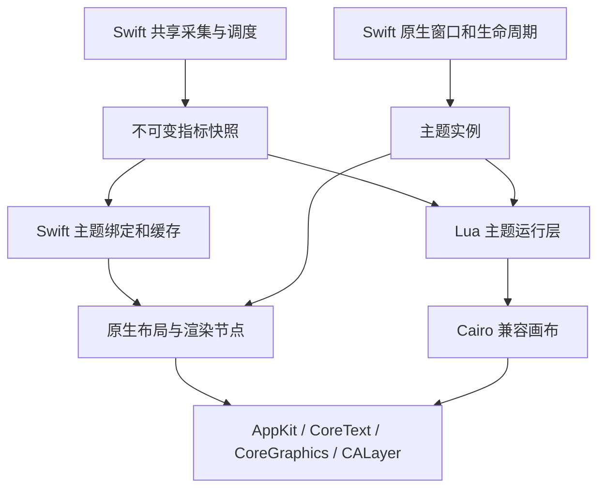

# Swift 原生架构与性能决策

日期：2026-10-14。项目：[cchen7/conkymac](https://github.com/cchen7/conkymac)。这是设计评估，尚未实现应用，也没有原生应用的性能测试结果。

## 1. 建议

**以 Swift 构建 ConkyMac 的原生运行核心，同时保留 Lua/Cairo 主题适配能力。** 原生主题使用 AppKit、CoreGraphics/CoreText、Core Animation；复杂 Lua 绘图主题先通过兼容路径复用，再按实际需求逐个转换。

Conky C++ 不必成为整个应用的宿主。它继续作为主题语义、模板行为及必要算法的参考；若首批主题需要大量历史语义，可临时复用独立片段，但不直接绑定其全局主循环和采集调度。

Swift 的价值在于 macOS 集成、类型化状态、生命周期与并发隔离。Swift 不天然比优化后的 C/C++ 更快；直接逐行翻译源码不会自动减少系统调用、分配、锁或重绘。运行效率应来自采集去重复、快照缓存、变化驱动更新和正确的算法。

## 2. 哪些模块值得用 Swift

| 模块 | 推荐实现 | 理由与边界 | 优先级 |
| --- | --- | --- | --- |
| 应用、窗口、生命周期 | Swift + AppKit；设置界面可用 SwiftUI | 原生窗口、显示器、唤醒、事件与应用资源定位；窗口操作明确放在主线程 | 首先 |
| 指标采集 | Swift 调用 Mach/sysctl/IOKit；必要时薄 C/Objective-C 桥 | 参考 Stats 的算法与型号映射，集中采集；不引入完整 Stats Kit/UI | 首先 |
| 调度、缓存、指标分发 | Swift；适当使用 actor 与 DispatchQueue | 多主题共用读数，控制周期、取消和过期；同步 IOKit/Lua 工作不能堵塞 UI | 首先 |
| 原生主题模型与有限模板 | Swift 类型化布局/绑定模型 | 配置加载时解析，运行时更新值；只实现精选主题真正使用的格式语义 | 首批主题阶段 |
| 原生绘制 | Swift + CoreGraphics/CoreText/CALayer | 缓存字体/布局/资源，按变化更新；根据内容选择绘制与图层，不能假定图层越多越快 | 首批主题阶段 |
| 配置/主题转换 | Swift 工具或应用导入流程 | 静态布局、指标、路径可转换；动态 Lua 与外部命令生成报告并人工适配 | 首个主题闭环后 |
| Lua 解释器 | 保留原有 C 实现，Swift 宿主 + 小型 C 桥 | 复用任意主题算法；没有必要用 Swift 重写解释器 | 保留 |
| Cairo 兼容绘图 | 保留 C 库，隔离在主题适配层 | 保留曲线、渐变、文字等已有脚本；按主题实测 CPU/拷贝/刷新成本 | 保留，后续按需迁移 |
| 系统 ABI/未公开传感器接口 | 小型 C/Objective-C 声明及包装 | Swift 可负责封装和状态；不要为语言统一重写底层 ABI | 保留小边界 |
| Metal 渲染器 | 暂不选择 | 常规时钟、条形图、圆环没有已测 GPU 瓶颈；有复杂动画证据时再评估 | 实测后决定 |

这里“重写”主要意味着新项目的对应功能用 Swift 重新设计，而不是把整个 Conky 搬入后再逐文件翻译。

## 3. 源码中能确认的成本来源

以下是源码观察与潜在成本，尚未通过 Time Profiler 对实际主题确认热点排序。

### 3.1 Conky Darwin 进程统计

`src/data/os/darwin.mm::get_top_info_for_kinfo_proc()` 为每个进程提交两个异步块，再用 `usleep(500)` 轮询等待。它调用的 `calc_cpu_total()` 又分配 CPU sample 并调用整机 `host_processor_info()`。

新采集层应每轮只采一次整机基线，再对进程做有界批量读取与差分。避免每进程重复整机读数、两次派发及轮询。`allocate_cpu_sample()` 还会覆盖全局 `sample_handle`，而该调用路径没有对应逐次释放，需关注所有权；本次没有做泄漏运行验证。

### 3.2 回调线程和等待

`src/update-cb.cc` 为每个启用回调懒创建持久线程，`run_all_callbacks()` 等待所有 `wait=true` 的回调。它已有相同参数回调合并，不能说完全没有去重复；但多个主题实例仍需要应用级共享采集，慢回调也不应阻塞图形事件处理。

Swift 方案使用少量采集队列和快照分发，不为每个显示控件建立定时器/系统读取。actor 用来保护状态，并不意味着 actor 本身就是专门的后台线程。

### 3.3 Lua 模板解析

`src/lua/llua.cc::llua_conky_parse()` 会分配输出缓冲和复制输入字符串，再调用 `src/conky.cc::evaluate()`；后者每次构造表达式对象、求值并释放。

对重复的 `${cpu}`、`${memperc}` 等可缓存解析结果，绑定到本帧指标快照。动态拼接的新表达式仍需解析，缓存要有容量上限；不能无限缓存任意脚本字符串，也不能忽略依赖外部命令或副作用的表达式语义。

### 3.4 重绘

Conky 的 `draw_stuff()` 在有更新时走绘制流程；开启文本描边时会做八次偏移绘制，再绘制前景。它没有证明所有主题都很慢，但常规原生主题可以缓存不变背景、图形路径与文字布局，避免整张画布重复生成。

对于已经能转成圆环节点的主题，可更新路径参数/图层属性；复杂混合效果仍可能适合一次画布绘制。两者以主题画面和实测成本决定。

### 3.5 Stats 也需要选择性参考

Stats 的 `Reader<T>` 关联 Store、DB、历史和模块分发；CPU 频率 reader 还会在 500ms 内取多次样本。另有读取路径启动 `pmset` 等进程。

应提取所需采集算法、单位转换、芯片频点表和缓存机制，重新设计周期。Stats 的读取方法可参考，其整套调度、持久化与 UI 不必引入。桌面监控不需要默认频繁写历史数据库或为普通指标启动 Shell。

## 4. 推荐数据流

原生路径是成品优先路径；兼容路径用于复用复杂脚本，不把它强行变成“自动转成任意原生节点”的通用编译器。

多主题仍可共享一次 CPU/网络/内存采样。Lua state 每主题独立、串行访问；Cairo 画布也不能跨队列同时修改。应用内共享 Swift 核心后，不再默认需要每个主题完整启动一个 Conky 进程。是否将某些高成本/外部脚本主题隔离到辅助进程，按实际需要决定。

## 5. 性能设计要点

1. **采集与显示不同频。** 常规指标先以 1 Hz 更新，电池/磁盘容量等可更低；动画有自己的按需帧节奏。传感器频率以误差和成本验证后确定。
2. **共享采集。** 十个 CPU 圆环引用同一快照，不进行十次系统调用。主题不再用 `${exec ...}` 启动命令来读取已有原生指标。
3. **解析一次。** 字体、表达式、布局、图片在导入/变更时准备；重复表达式使用有界缓存。历史图表使用有限长度缓冲。
4. **只更新变化部分。** 静态资源缓存，数值不变就不重绘；不要强制所有窗口保持 60 FPS。缩放和显示器变化会使相应缓存失效。
5. **少量有明确所有权的任务。** 采集、主题求值、画布生成与主线程提交分开；不为每个指标创建 actor/线程。采样超时或旧任务结果不能覆盖较新的状态。
6. **处理可见性。** 用真实窗口/应用事件判断休眠、隐藏和需要显示的窗口；不要假定桌面窗口的 occlusion 状态在所有 Spaces 场景完全可靠。
7. **内存有边界。** 布局、表达式、图片及历史缓存均限定容量。64 GiB 开发机不成为成品无界缓存的理由。
8. **先用可解释的常规渲染。** Core Animation 合成可减少部分重新绘制工作，但复杂阴影、半透明大面积、过多图层也有成本；没有实测瓶颈前不增加 Metal 管线。

原生和兼容渲染可以共存，但需要明确图层顺序、透明合成、坐标、缩放和画布所有权，不能让每个 Lua 绘图调用跨到主线程改变图层。

## 6. Swift 与 Lua/C 的边界

当前机器 Swift 6.4。Context7 的 Swift 并发迁移文档确认 `Task {}` 会继承其上下文的 actor 隔离；在 MainActor 中包一层 Task，不等于把同步采集或 Lua 绘图移到后台。同步阻塞 API 使用明确的采集队列；可挂起操作可以使用 async/await，不能通过等待信号量阻塞协作线程池。

Swift 可直接导入 C 函数和指针；函数宏则需要薄包装。例如本机 Lua 5.5.1 的 `luaL_openlibs` 是函数式宏，临时验证通过静态 C inline 包装解决。Lua 版本需在主题验证后固定，不能把本机版本自动当成所有历史脚本的兼容保证。

Lua `longjmp`、panic 与宿主语言栈也是实现边界：脚本入口使用受保护调用；可能调用 `lua_error/luaL_error` 的 C 路径避免跨越 Swift frame。错误处理用小型 C trampoline/包装，不直接让 Swift 回调随意抛出 Lua 错误。

### 已执行的验证

临时目录 `/private/tmp/conky-feasibility-20261014/swift-lua-probe`：

- Swift 优化构建 `swiftc -O -j 16` 成功，直接链接现有 Lua C 库。
- Swift 构造指标 table，Lua 读取测试值并返回字符串：`SWIFT_LUA_OK cpu=42 memory=25`。
- 预期脚本错误由 `lua_pcallk` 返回非成功状态，进程继续正常退出：`LUA_ERROR_BOUNDARY_OK status=2`。
- 该验证使用固定测试值，只证明宿主/解释器边界可行；没有实现 `conky_parse()`、Cairo 绘图、原生窗口、多主题或完整错误恢复。

此前 Stats SMC Swift 探针已经成功读取本机温度，进一步说明 Swift 可以承担采集宿主。依然没有“Swift 比 Conky 快多少”的对照数据。

## 7. 如何验收高性能

采用 Release/优化构建，分开统计原生路径与 Lua/Cairo 路径；不能把原 Conky Debug 命令行版本和新 Release GUI 直接当成公平对照。

测试负载固定主题尺寸、字体、缩放、输入数据、刷新频率与窗口数量，至少包含：

| 场景 | 观察指标 |
| --- | --- |
| 1 / 3 / 10 个普通主题，1 Hz | 应用及辅助进程 CPU、每轮采集次数、绘制时间、线程、唤醒次数、常驻内存 |
| 时钟/圆环动画 | 帧时间 p50/p95、主线程耗时、卡顿、CPU/GPU 合成成本 |
| 相同主题原生与 Cairo 版本 | 视觉差异、绘制/拷贝/提交时间，区分模板求值与渲染成本 |
| 10 分钟后稳定状态 | 内存增长趋势、缓存规模、无界任务或资源残留 |
| 隐藏/睡眠/唤醒/多屏变化 | 采集暂停或降频、恢复延迟、缓存重建正确性 |
| 慢脚本/不可用传感器 | UI 响应、超时处理、数据年龄与降级 |

首个闭环后固定数值预算：静态主题关注接近空闲的平均 CPU；动态主题关注每帧预算与卡顿。CPU 百分比应注明单逻辑核或整机归一化，主线程耗时、内存和功耗应分别记录，避免用强硬件掩盖效率问题。

本机 Instruments 模板列表已验证可用：Time Profiler、Allocations、Leaks、Power Profiler、Swift Concurrency 等。首次沙箱调用因 Instruments 缓存目录权限失败；宿主只读列举成功。**尚未录制原生应用的 profile**。

## 8. 实施顺序

1. Swift 应用/窗口与共享指标快照原型，确认主线程和采集隔离。
2. 一个文字/圆环原生主题，建立固定输入视觉与性能基线。
3. Swift 嵌入 Lua，迁移一个真实 Cairo 主题，衡量兼容路径成本。
4. 实现所需的模板子集和有界表达式缓存，并添加有限转换规则。
5. 以实际主题决定继续转换哪些部件、保留哪些 Lua/Cairo 绘图；优化来源于 profile。

首版允许原生主题和适配主题的支持范围不同。不要先实现全部 Conky 功能，也不要为纯语言统一重写 Lua/Cairo。

## 9. 资料

- Conky 对应提交：`0bee35ce5befb7d84bb7494cd83c2313dac75387`；核心文件见上述路径。
- Stats 对应提交：`88d5359ad3466efaa16985646a0bb15c6599109f`；`SMC/smc.swift`、`Kit/module/reader.swift`、`Kit/plugins/Repeater.swift`、`Modules/CPU/readers.swift`。
- [Swift 并发迁移说明](https://github.com/swiftlang/swift-migration-guide/blob/main/Guide.docc/DataRaceSafety.md)
- [Swift C API 导入说明](https://github.com/swiftlang/swift/blob/main/docs/HowSwiftImportsCAPIs.md)
- [AppKit layerContentsRedrawPolicy](https://developer.apple.com/documentation/appkit/nsview/layercontentsredrawpolicy-swift.property)
- [AppKit wantsUpdateLayer](https://developer.apple.com/documentation/appkit/nsview/wantsupdatelayer)
- [AppKit updateLayer](https://developer.apple.com/documentation/appkit/nsview/updatelayer%28%29)

官方 API 文档通过 Context7 查询；关于热点成本的结论来自源码观察，速度提升需后续实测。
